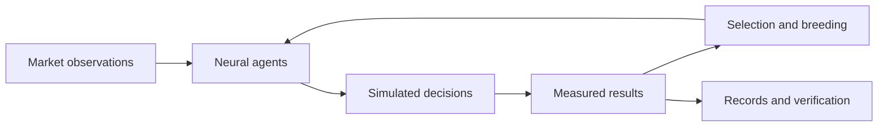

# Synora · Evolution Observatory

**Watch neural agents evolve. Explore their decisions. Check the evidence.**

Synora makes evolutionary AI research visible: small neural networks receive
market data, make simulated decisions, compete and pass their genomes to the next
generation. An interactive observatory connects the agents, the selection process
and the records needed to inspect their behavior.

**[Explore the project and visual tour →](https://github.com/SynoraObservatory/Synora#readme)**

| Explore | What you can understand |
| --- | --- |
| **Observatory** | How a neural agent responds to its inputs |
| **Selection** | How survival, crossover and mutation change a population |
| **Lab** | How parent genomes produce a child and how results can be verified |
| **SYNR** | The planned token and its future role in the Lab |

<strong>How does the AI learn?</strong>

The population evolves through selection, crossover and mutation. Agents use
small neural networks, and their decisions can be replayed. This is an experiment
in evolutionary computation; it is not evidence of profitable market prediction.

<strong>Is SYNR live?</strong>

No. SYNR issuance is planned through Montra. No official Synora token address is
published, and token transactions in the current interface are disabled. The
observatory currently presents research data; an independent Synora deployment
remains planned.

<strong>Does the project trade user funds?</strong>

The research agents make simulated trades. The project does not promise returns.
Planned Lab payments and token-market activity are separate from those simulated
decisions.

This profile and its linked showcase contain a public product presentation.
Application development is maintained separately.
